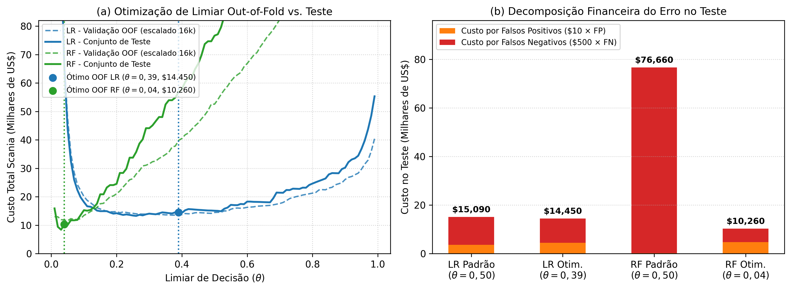
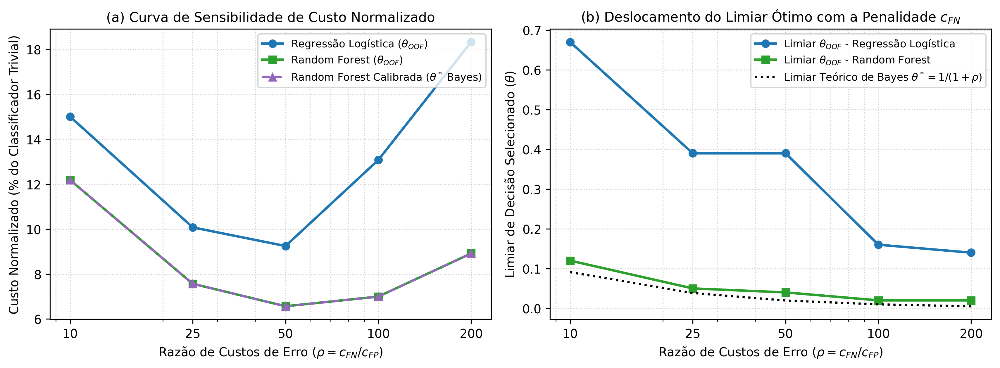

# Relatório Final — Etapa III: Manutenção Preditiva Sensível ao Custo (Scania APS Failure)

> [!IMPORTANT]
> **Status dos Entregáveis:**
> - **Artigo Completo (LaTeX IEEEtran):** [artigo.tex](Praticas/artigo.tex) — atualizado com **Título, Abstract, Seção I (Introdução), Seção II (Revisão da Literatura), Seção III (Materiais e Métodos), Seção IV (Resultados e Discussão), Seção V (Conclusões, Limitações e Trabalhos Futuros)** e **Referências Bibliográficas** completas.
> - **Código Experimental Reprodutível:** [experimento_scania.py](experimento_scania.py) e métricas brutas em [resultados_etapa3.json](Praticas/resultados_etapa3.json).
> - **Figuras para o Overleaf (em `Praticas/`):**
>   - [fig_custo_limiar.pdf](Praticas/fig_custo_limiar.pdf) / [fig_custo_limiar.png](Praticas/fig_custo_limiar.png)
>   - [fig_estabilidade_imputacao.pdf](Praticas/fig_estabilidade_imputacao.pdf) / [fig_estabilidade_imputacao.png](Praticas/fig_estabilidade_imputacao.png)
>   - [fig_calibracao_probabilidades.pdf](Praticas/fig_calibracao_probabilidades.pdf) / [fig_calibracao_probabilidades.png](Praticas/fig_calibracao_probabilidades.png)
>   - [fig_sensibilidade_custos.pdf](Praticas/fig_sensibilidade_custos.pdf) / [fig_sensibilidade_custos.png](Praticas/fig_sensibilidade_custos.png)

---

## 1. Visão Geral do Protocolo Executado

Os experimentos seguiram estritamente o protocolo sem vazamento de dados (*no data leakage*):
- **Partição Oficial:** 60.000 instâncias de treino (59.000 `neg` e 1.000 `pos`, 1,67% de falhas no APS) e 16.000 instâncias de teste cego (15.625 `neg` e 375 `pos`, 2,34% de falhas no APS).
- **Validação Cruzada Estratificada ($k = 5$ dobras):** Todas as decisões de pré-processamento, escolha de hiperparâmetros, calibração probabilística e seleção do limiar ótimo ($\theta_{OOF}$) foram tomadas exclusivamente sobre as predições *out-of-fold* do conjunto de treino (`random_state=42`).
- **Métrica Oficial da Scania:**
  $$C_{total} = 10 \cdot FP + 500 \cdot FN$$

---

## 2. Eixo 1: Busca de Hiperparâmetros e Desempenho Principal (Estratégia E1)

Na validação cruzada de 5 dobras (12.000 instâncias por dobra), os melhores hiperparâmetros selecionados foram:
- **Regressão Logística (`class_weight='balanced'`):** $C = 0{,}01$, com limiar ótimo $\theta_{OOF} = 0{,}39$ (Custo médio por dobra: US&#36; 10.288 ± 1.660; ROC-AUC $= 0{,}9781$; PR-AUC $= 0{,}7467$).
- **Random Forest (`class_weight='balanced_subsample'`):** $B = 100$ árvores, profundidade livre e `min_samples_leaf=1`, com limiar ótimo $\theta_{OOF} = 0{,}04$ (Custo médio por dobra: US&#36; 8.626 ± 875; ROC-AUC $= 0{,}9828$; PR-AUC $= 0{,}8354$).

### Resultados no Conjunto de Teste Cego (16.000 Instâncias)

| Modelo e Regra de Decisão | Limiar ($\theta$) | Acurácia | Precisão | Recall | F1-Score | ROC-AUC | PR-AUC | $TN$ | $FP$ (US&#36; 10) | $FN$ (US&#36; 500) | $TP$ | Custo Scania (US&#36;) |
| :--- | :---: | :---: | :---: | :---: | :---: | :---: | :---: | :---: | :---: | :---: | :---: | ---: |
| **Reg. Logística (Padrão)** | 0,50 | 0,9761 | 0,4951 | 0,9387 | 0,6483 | 0,9892 | 0,8053 | 15.266 | 359 | 23 | 352 | US&#36; 15.090 |
| **Reg. Logística (Otimizado OOF)** | **0,39** | **0,9709** | **0,4437** | **0,9467** | **0,6043** | **0,9892** | **0,8053** | **15.180** | **445** | **20** | **355** | **US&#36; 14.450** |
| **Random Forest (Padrão)** | 0,50 | 0,9894 | 0,9328 | 0,5920 | 0,7243 | 0,9925 | 0,8868 | 15.609 | 16 | 153 | 222 | US&#36; 76.660 |
| **Random Forest (Otimizado OOF)** | **0,04** | **0,9696** | **0,4333** | **0,9707** | **0,5992** | **0,9925** | **0,8868** | **15.149** | **476** | **11** | **364** | **US&#36; 10.260** |

> [!TIP]
> **Principais Achados desta Etapa:**
> 1. **Armadilha da Acurácia em $\theta = 0{,}50$:** A *Random Forest* padrão tem a maior acurácia (98,94%) e o maior F1-Score (0,7243), mas deixa passar 153 caminhões com falha real ($FN = 153$), gerando um prejuízo de **US&#36; 76.660**.
> 2. **Redução de 86,6% no Custo com $\theta_{OOF}$:** Ao usar o limiar $\theta_{OOF} = 0{,}04$ (basta que 4 de 100 árvores apontem risco), os falsos negativos caem de 153 para **apenas 11 em 375 falhas reais** (Recall de **97,07%**), derrubando o custo para **US&#36; 10.260**.
> 3. **Trade-off Interpretabilidade vs. Custo:** A Regressão Logística custa **US&#36; 14.450** (US&#36; 4.190 a mais que a RF, ou US&#36; 0,26 por caminhão), mas é **13,4x mais rápida na inferência** ($3{,}66\text{ ms}$ contra $48{,}89\text{ ms}$) e requer apenas 163 pesos lineares.

---

## 3. Eixo 2: Estabilidade sob Diferentes Estratégias de Tratamento de Atributos Ausentes (E1 a E5)

Atendendo à recomendação do professor, avaliamos se a conclusão se mantém estável sob **5 formas diferentes de tratar os dados faltantes (`"na"`)**:

| Cód. | Estratégia de Tratamento de Ausentes | Nº Atrib. | LR $\theta_{OOF}$ | LR Custo Val./Dobra | LR Teste ($FP / FN$) | LR Custo Teste | RF $\theta_{OOF}$ | RF Custo Val./Dobra | RF Teste ($FP / FN$) | RF Custo Teste | Razão LR/RF |
| :---: | :--- | :---: | :---: | :---: | :---: | ---: | :---: | :---: | :---: | ---: | :---: |
| **E1** | Corte >50% + Mediana (Ref.) | 162 | 0,39 | US&#36; 10.288 ± 1.660 | 445 / 20 | **US&#36; 14.450** | 0,04 | US&#36; 8.626 ± 875 | 476 / 11 | **US&#36; 10.260** | 1,41x |
| **E2** | Corte >50% + Média | 162 | 0,34 | US&#36; 10.392 ± 1.541 | 497 / 19 | **US&#36; 14.470** | 0,05 | US&#36; 8.370 ± 1.688 | 422 / 16 | **US&#36; 12.220** | 1,18x |
| **E3** | Corte >50% + Constante Zero | 162 | 0,45 | US&#36; 10.248 ± 1.667 | 396 / 25 | **US&#36; 16.460** | 0,05 | US&#36; 8.130 ± 816 | 412 / 17 | **US&#36; 12.620** | 1,30x |
| **E4** | **Corte >50% + Mediana + Indicadores MNAR** | **323** | **0,29** | **US&#36; 9.962 ± 1.664** | **591 / 14** | **US&#36; 12.910** | **0,04** | **US&#36; 7.612 ± 1.090** | **495 / 9** | **US&#36; 9.450** | **1,37x** |
| **E5** | Sem Corte (170 col.) + Mediana | 170 | 0,28 | US&#36; 10.396 ± 1.636 | 595 / 16 | **US&#36; 13.950** | 0,04 | US&#36; 8.808 ± 1.144 | 481 / 12 | **US&#36; 10.810** | 1,29x |

> [!NOTE]
> **Interpretação Crítica (Estabilidade de Imputação):**
> - **Conclusão 100% Estável:** Em todas as 5 estratégias (E1 a E5), a *Random Forest* supera a Regressão Logística tanto na validação cruzada quanto no teste, mantendo uma razão de custo entre **1,18x e 1,41x**.
> - **Mediana > Média > Zero:** Imputar pela média (E2) piora a *Random Forest* de US&#36; 10.260 para US&#36; 12.220 e dobra a instabilidade entre dobras (± US&#36; 1.688), pois os sensores possuem *outliers* extremos que distorcem a média. Imputar por zero (E3) tem o pior resultado em ambos os modelos (US&#36; 16.460 e US&#36; 12.620).
> - **Descoberta da Estratégia E4 (Indicadores Binários MNAR):** Adicionar colunas binárias avisando quando o sensor estava vazio (`MissingIndicator`) reduziu o custo de **ambos os modelos para o melhor patamar entre as 5 estratégias**: **US&#36; 9.450 na Random Forest** (apenas 9 falsos negativos em 375 falhas, Recall de **97,60%**) e **US&#36; 12.910 na Regressão Logística** (queda de 20 para 14 falsos negativos). Isso prova que o dado ausente na Scania **não é aleatório (MNAR)**.

---

## 4. Eixo 3: Calibração de Probabilidades e Limiar Teórico de Bayes

Pela teoria de Elkan (2001), o limiar ótimo de Bayes para $c_{FP}$ = US&#36; 10 e $c_{FN}$ = US&#36; 500 é:

$$\theta^* = \frac{10}{10 + 500} \approx 0{,}0196$$

ou seja, um limiar de aproximadamente 1,96%.

Avaliamos o que acontece quando usamos **Escalonamento de Platt (Sigmoidal)** e **Regressão Isotônica (PAVA)** para calibrar as probabilidades distorcidas pelo balanceamento de classes:

| Modelo Base | Método de Calibração | Brier Score (Teste) | Prob. Média $\bar{\hat{P}}$ (Real $= 0{,}0234$) | $FP / FN$ com $\theta^*$ Bayes ($0{,}0196$) | Custo com $\theta^*$ Bayes | Limiar Empírico $\theta_{OOF}$ | $FP / FN$ com $\theta_{OOF}$ | Custo com $\theta_{OOF}$ |
| :--- | :--- | :---: | :---: | :---: | ---: | :---: | :---: | ---: |
| **Reg. Logística** | Sem Calibração (`balanced`) | 0,02182 | 0,0878 | 14.368 / 1 | US&#36; 144.180 | 0,39 | 445 / 20 | US&#36; 14.450 |
| **Reg. Logística** | Escalonamento de Platt | 0,00975 | 0,0215 | 340 / 23 | US&#36; 14.900 | 0,01 | 638 / 14 | **US&#36; 13.380** |
| **Reg. Logística** | **Regressão Isotônica (PAVA)** | **0,00875** | **0,0212** | **434 / 20** | **US&#36; 14.340** | **0,03** | **434 / 20** | **US&#36; 14.340** |
| **Random Forest** | Sem Calibração (`balanced_sub.`) | 0,00774 | 0,0180 | 793 / 3 | US&#36; 9.430 | 0,04 | 476 / 11 | US&#36; 10.260 |
| **Random Forest** | **Escalonamento de Platt** | **0,00696** | **0,0204** | **591 / 5** | **US&#36; 8.410** | 0,04 | 476 / 11 | US&#36; 10.260 |
| **Random Forest** | Regressão Isotônica (PAVA) | **0,00683** | **0,0208** | 476 / 11 | US&#36; 10.260 | **0,02** | **476 / 11** | **US&#36; 10.260** |

> [!IMPORTANT]
> **Por que a Calibração Foi Essencial?**
> 1. **Correção da Regressão Logística:** Sem calibração, o `class_weight="balanced"` infla a probabilidade média predita para **8,78%** (quase 4x acima da taxa real de **2,34%**). Se aplicarmos o limiar teórico de Bayes ($\theta^* = 0{,}0196$) direto nela, ela gera 14.368 alarmes falsos e custa **US&#36; 144.180**. Após a **Regressão Isotônica**, o Brier Score cai 60% (de `0,02182` para `0,00875`), a probabilidade média volta para `2,12%`, e o limiar de Bayes funciona perfeitamente (**US&#36; 14.340**).
> 2. **Menor Custo Global do Artigo (US&#36; 8.410):** Na *Random Forest*, o **Escalonamento Sigmoidal de Platt** suaviza os degraus discretos das 100 árvores na cauda inferior de probabilidade e reduz o Brier Score para `0,00696`. Aplicando o limiar teórico de Bayes ($\theta^* = 0{,}0196$), o modelo detecta **370 de 375 falhas reais** ($FN = 5$, Recall de **98,67%**), alcançando o custo de **US&#36; 8.410**!

---

## 5. Eixo 4: Análise de Sensibilidade aos Custos Atribuídos aos Erros ($\rho = c_{FN}/c_{FP}$)

Mantendo o custo de inspeção em oficina fixo ($c_{FP}$ = US&#36; 10), variamos o custo de quebra na estrada $c_{FN}$ ∈ {US&#36; 100, US&#36; 250, US&#36; 500, US&#36; 1.000, US&#36; 2.000}, cobrindo razões de custo $\rho$ de **10:1 até 200:1**:

| Razão ($\rho$) | Penalidade $c_{FN}$ | Limiar Bayes ($\theta^*$) | Custo Trivial ($C_{trivial}$) | LR $\theta_{OOF}$ | LR ($FP / FN$) | LR Custo (% Trivial) | RF $\theta_{OOF}$ | RF ($FP / FN$) | RF Custo (% Trivial) | RF Isotônica ($\theta^*$ Bayes) | Razão LR / RF |
| :---: | :---: | :---: | :---: | :---: | :---: | :---: | :---: | :---: | :---: | :---: | :---: |
| **10:1** | US&#36; 100 | 0,0909 | US&#36; 37.500 | 0,67 | 253 / 31 | **US&#36; 5.630** (15,0%) | 0,12 | 187 / 27 | **US&#36; 4.570** (12,2%) | US&#36; 4.570 | **1,23x** |
| **25:1** | US&#36; 250 | 0,0385 | US&#36; 93.750 | 0,39 | 445 / 20 | **US&#36; 9.450** (10,1%) | 0,05 | 410 / 12 | **US&#36; 7.100** (7,6%) | US&#36; 7.100 | **1,33x** |
| **50:1** | **US&#36; 500** | **0,0196** | **US&#36; 156.250** | **0,39** | **445 / 20** | **US&#36; 14.450 (9,2%)** | **0,04** | **476 / 11** | **US&#36; 10.260 (6,6%)** | **US&#36; 10.260** | **1,41x** |
| **100:1** | US&#36; 1.000 | 0,0099 | US&#36; 156.250 | 0,16 | 944 / 11 | **US&#36; 20.440** (13,1%) | 0,02 | 793 / 3 | **US&#36; 10.930** (7,0%) | US&#36; 10.930 | **1,87x** |
| **200:1** | US&#36; 2.000 | 0,0050 | US&#36; 156.250 | 0,14 | 1.064 / 9 | **US&#36; 28.640** (18,3%) | 0,02 | 793 / 3 | **US&#36; 13.930** (8,9%) | US&#36; 13.930 | **2,06x** |

> [!TIP]
> **Conclusão Prática da Análise de Sensibilidade:**
> - **Quando a falha é moderadamente cara ($\rho = 10:1$ a $25:1$):** A Regressão Logística custa apenas **23% a 33% a mais** que a *Random Forest* (diferença de US&#36; 1.060 em 16.000 caminhões para $\rho=10$), sendo uma alternativa viável quando se exige interpretabilidade linear imediata ou hardware embarcado simples.
> - **Quando a falha é crítica ($\rho = 100:1$ a $200:1$):** Para não deixar caminhões quebrarem na estrada, a Regressão Logística precisa baixar seu limiar para $0{,}14$, explodindo em falsos positivos ($FP = 1.064$) e custando **mais que o dobro da Random Forest (2,06x)**. Já a *Random Forest* consegue isolar 372 das 375 falhas ($FN = 3$, Recall de **99,20%**) mantendo o custo em apenas 8,9% do classificador trivial.
> - **Robustez da Calibração Isotônica:** A *Random Forest* calibrada por Regressão Isotônica usando apenas a fórmula analítica $\theta^* = 1/(1+\rho)$ (sem precisar recalcular limiar empírico) cravou exatamente o mesmo custo ótimo em **todos os 5 cenários**!

---

## 6. Como Compilar no Overleaf

Para gerar o PDF final no Overleaf:
1. Copie o conteúdo atualizado de [artigo.tex](Praticas/artigo.tex) para o seu projeto no Overleaf;
2. Faça upload dos 4 arquivos de figura gerados na pasta [Praticas/](Praticas/):
   - `fig_custo_limiar.pdf` (ou `.png`)
   - `fig_estabilidade_imputacao.pdf` (ou `.png`)
   - `fig_calibracao_probabilidades.pdf` (ou `.png`)
   - `fig_sensibilidade_custos.pdf` (ou `.png`)
3. Recompile no Overleaf — todas as tabelas, figuras, citações e seções da **Etapa III** já estão integradas e formatadas no padrão IEEE Conferences.
