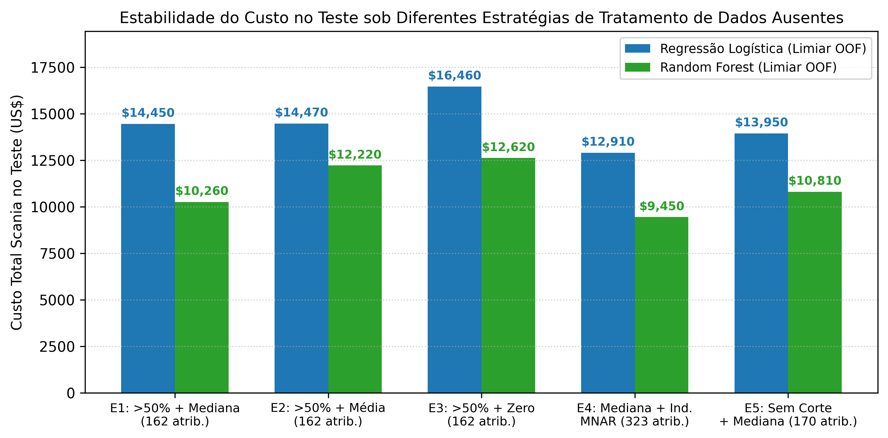
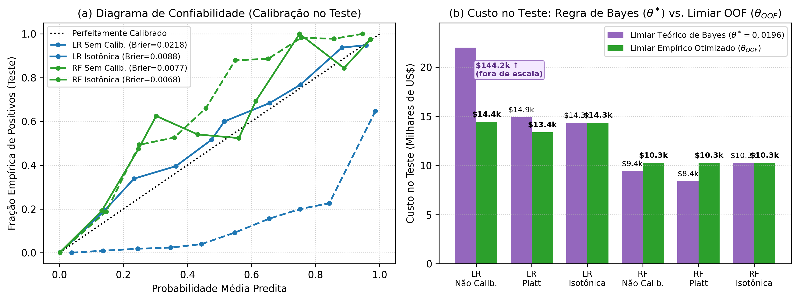

# Relatório Técnico e Apêndice de Tabelas Completas — Diagnóstico de Falhas no Sistema de Pressão de Ar de Veículos Pesados (Scania APS Failure)

> [!IMPORTANT]
> **Status dos Entregáveis:**
> - **Artigo Completo (LaTeX IEEEtran):** [artigo.tex](Praticas/artigo.tex) — intitulado *"Diagnóstico de Falhas no Sistema de Pressão de Ar de Veículos Pesados: Uma Abordagem Sensível ao Custo Baseada em Aprendizado de Máquina"*.
> - **Código Experimental Reprodutível:** [experimento_scania.py](experimento_scania.py) e métricas completas em [resultados_etapa3.json](Praticas/resultados_etapa3.json).
> - **Figuras Científicas (`Praticas/`):**
>   - [fig_custo_limiar.pdf](Praticas/fig_custo_limiar.pdf) / [fig_custo_limiar.png](Praticas/fig_custo_limiar.png)
>   - [fig_estabilidade_imputacao.pdf](Praticas/fig_estabilidade_imputacao.pdf) / [fig_estabilidade_imputacao.png](Praticas/fig_estabilidade_imputacao.png)
>   - [fig_calibracao_probabilidades.pdf](Praticas/fig_calibracao_probabilidades.pdf) / [fig_calibracao_probabilidades.png](Praticas/fig_calibracao_probabilidades.png)
>   - [fig_sensibilidade_custos.pdf](Praticas/fig_sensibilidade_custos.pdf) / [fig_sensibilidade_custos.png](Praticas/fig_sensibilidade_custos.png)

---

## 1. Visão Geral do Protocolo Executado

Os experimentos seguiram estritamente o protocolo sem vazamento de dados (*no data leakage*):
- **Natureza da Tarefa e Partição Oficial:** Os registros provêm de caminhões pesados da Scania que apresentaram falha; a classe positiva (`pos`) indica falha em um componente específico do Sistema de Pressão de Ar (APS) e a classe negativa (`neg`) indica falha em componentes não relacionados ao APS. O conjunto de treino possui 60.000 instâncias (59.000 `neg` e 1.000 `pos`, 1,67% de falhas no APS) e o conjunto de teste cego possui 16.000 instâncias (15.625 `neg` e 375 `pos`, 2,34% de falhas no APS; prevalência global de $\approx 1{,}81\%$).
- **Validação Cruzada Estratificada e Aninhada ($k = 5$ dobras):** Todas as decisões de pré-processamento, escolha de hiperparâmetros, calibração probabilística e seleção do limiar ótimo ($\theta_{OOF}$) foram tomadas exclusivamente sobre o conjunto de treino (`random_state=42`). Para eliminar o otimismo da seleção de limiar, reporta-se também o custo em **validação cruzada aninhada (*Nested CV*)**, escolhendo o limiar $\theta^{(-k)}_{OOF}$ nas 4 dobras internas e avaliando na dobra retida.
- **Métrica Oficial de Custo e Testes Estatísticos (*Bootstrap* Pareado):**
  $$C_{total} = 10 \cdot FP + 500 \cdot FN$$
  onde $FP$ contabiliza verificações diagnósticas desnecessárias do APS em oficina (US&#36; 10) e $FN$ contabiliza falhas reais do APS não diagnosticadas (US&#36; 500). No teste cego, os intervalos de confiança percentílicos de 95% ($IC_{95\%}$) e a significância das diferenças ($\Delta C = C_{LR} - C_{RF}$) são estimados por reamostragem *bootstrap* pareada ($B_{boot} = 10.000$), reportando tanto $p$-valores unilaterais ($p_{uni}$, para a hipótese direcional motivada pelo benchmark $C_{RF} < C_{LR}$) quanto bilaterais ($p_{bi}$) sem correção para múltiplos testes.

---

## 2. Eixo 1: Busca de Hiperparâmetros, Desempenho Principal (E1) e Interpretabilidade

Na validação cruzada de 5 dobras (12.000 instâncias por dobra), as melhores configurações selecionadas foram:
- **Regressão Logística (`class_weight='balanced'`, $\omega_{pos}=30{,}0$, $\omega_{neg}\approx 0{,}5085$, razão $\omega_{pos}/\omega_{neg}=59$):** $C = 0{,}01$, com limiar ótimo $\theta_{OOF} = 0{,}39$ (Custo OOF por dobra: US&#36; 10.288 ± 1.660; Custo *Nested CV* por dobra: US&#36; 10.490 ± 1.552; ROC-AUC $= 0{,}9781$; PR-AUC $= 0{,}7467$, em empate prático com $C = 0{,}001$, que obteve US&#36; 10.368 ± 1.177).
- **Random Forest (`class_weight='balanced_subsample'`):** $B = 100$ árvores, profundidade livre e `min_samples_leaf=1`, com limiar ótimo $\theta_{OOF} = 0{,}04$ (Custo OOF por dobra: US&#36; 8.626 ± 875; Custo *Nested CV* por dobra: US&#36; 8.804 ± 781; ROC-AUC $= 0{,}9828$; PR-AUC $= 0{,}8354$, em empate prático com `max_depth=20, min_samples_leaf=5` e `max_depth=None, min_samples_leaf=5`).

### Tabela Completa do Conjunto de Teste Cego (16.000 Instâncias — Estratégia Primária E1)

| Modelo e Regra de Decisão | Limiar ($\theta$) | Acurácia | Precisão | Recall | F1-Score | ROC-AUC | PR-AUC | $TN$ | $FP$ (US&#36; 10) | $FN$ (US&#36; 500) | $TP$ | Custo Scania ($IC_{95\%}$) |
| :--- | :---: | :---: | :---: | :---: | :---: | :---: | :---: | :---: | :---: | :---: | :---: | ---: |
| **Reg. Logística (Padrão)** | 0,50 | 0,9761 | 0,4951 | 0,9387 | 0,6483 | 0,9892 | 0,8053 | 15.266 | 359 | 23 | 352 | US&#36; 15.090 |
| **Reg. Logística (Otimizado OOF)** | **0,39** | 0,9709 | 0,4437 | 0,9467 | 0,6043 | 0,9892 | 0,8053 | 15.180 | 445 | 20 | 355 | **US&#36; 14.450** ([10.330; 19.050]) |
| **Random Forest (Padrão)** | 0,50 | **0,9894** | **0,9328** | 0,5920 | **0,7243** | **0,9925** | **0,8868** | **15.609** | **16** | 153 | 222 | US&#36; 76.660 |
| **Random Forest (Otimizado OOF)** | **0,04** | 0,9696 | 0,4333 | **0,9707** | 0,5992 | **0,9925** | **0,8868** | 15.149 | 476 | **11** | **364** | **US&#36; 10.260** ([7.250; 13.780]) |

> [!TIP]
> **Principais Achados desta Etapa:**
> 1. **Paradoxo da Acurácia em $\theta = 0{,}50$:** A *Random Forest* padrão tem a maior acurácia (98,94%) e o maior F1-Score (0,7243), mas deixa escapar 153 falhas reais do APS ($FN = 153$), gerando um custo de **US&#36; 76.660**.
> 2. **Redução de 86,6% no Custo com $\theta_{OOF}$:** Ao usar o limiar $\theta_{OOF} = 0{,}04$ (ao menos 4 de 100 árvores), os falsos negativos caem de 153 para **11 em 375 falhas reais** (Recall de **97,07%**), reduzindo o custo para **US&#36; 10.260** (média de **US&#36; 10.008 ± 1.082** ao longo de 5 sementes independentes: `{42: 10.260, 7: 8.930, 13: 8.820, 21: 11.110, 99: 10.920}`).
> 3. **Trade-off Interpretabilidade vs. Custo:** A Regressão Logística custa **US&#36; 14.450** ($\Delta C = +\text{US&#36; } 4.190$, $IC_{95\%}: [+\text{US&#36; } 250;\; +\text{US&#36; } 8.320]$, $p_{uni} = 0{,}0185$, $p_{bi} = 0{,}0370$), mas é **13,4x mais rápida na inferência** ($3{,}66\text{ ms}$ contra $48{,}89\text{ ms}$) e **2,9x mais rápida no treino** ($2{,}45\text{ s}$ contra $7{,}13\text{ s}$).

### Apêndice da Tabela V do Artigo: Top-10 Completo de Interpretabilidade (Estratégia E1)

Nos 162 atributos ativos da Estratégia E1, observa-se **correlação positiva fraca, porém estatisticamente significativa**, entre a magnitude dos coeficientes padronizados $|w_j|$ da Regressão Logística e a redução média de impureza de Gini da *Random Forest* ($\rho_S = 0{,}2675$, $p = 5{,}78 \times 10^{-4}$). Ambos convergem nos sensores primários `aa_000` e `ck_000`:

| Rank LR | Atributo (Top-10 LR) | $w_j$ | $\text{OR} = e^{w_j}$ | Gini (Rank RF) | Nulos | Rank RF | Atributo (Top-10 RF) | Imp. Gini | $w_j$ (Rank LR) | $\text{OR}$ (LR) | Nulos |
| :---: | :--- | :---: | :---: | :---: | :---: | :---: | :--- | :---: | :---: | :---: | :---: |
| **1º** | `aa_000` | $+0{,}9745$ | $2{,}650$ | 0,0563 (4º) | 0,0% | **1º** | `ck_000` | 0,1166 | $+0{,}6835$ (4º) | $1{,}981$ | 0,6% |
| **2º** | `by_000` | $+0{,}7851$ | $2{,}193$ | 0,0087 (28º) | 0,8% | **2º** | `ci_000` | 0,0846 | $+0{,}2183$ (37º) | $1{,}244$ | 0,6% |
| **3º** | `cb_000` | $-0{,}6898$ | $0{,}502$ | 0,0013 (75º) | 1,2% | **3º** | `dn_000` | 0,0599 | $+0{,}0864$ (91º) | $1{,}090$ | 1,2% |
| **4º** | `ck_000` | $+0{,}6835$ | $1{,}981$ | 0,1166 (1º) | 0,6% | **4º** | `aa_000` | 0,0563 | $+0{,}9745$ (1º) | $2{,}650$ | 0,0% |
| **5º** | `bs_000` | $+0{,}6290$ | $1{,}876$ | 0,0025 (49º) | 1,2% | **5º** | `bv_000` | 0,0459 | $+0{,}0336$ (134º) | $1{,}034$ | 1,2% |
| **6º** | `cn_001` | $+0{,}5897$ | $1{,}804$ | 0,0042 (37º) | 1,1% | **6º** | `bt_000` | 0,0459 | $-0{,}4430$ (13º) | $0{,}642$ | 0,3% |
| **7º** | `db_000` | $-0{,}5610$ | $0{,}571$ | 0,0004 (136º) | 23,0% | **7º** | `bj_000` | 0,0428 | $-0{,}0778$ (100º) | $0{,}925$ | 1,0% |
| **8º** | `ee_005` | $+0{,}5347$ | $1{,}707$ | 0,0026 (46º) | 1,1% | **8º** | `bu_000` | 0,0360 | $+0{,}0336$ (133º) | $1{,}034$ | 1,2% |
| **9º** | `aq_000` | $+0{,}5125$ | $1{,}669$ | 0,0207 (13º) | 1,0% | **9º** | `cq_000` | 0,0337 | $+0{,}0336$ (135º) | $1{,}034$ | 1,2% |
| **10º** | `dg_000` | $+0{,}5104$ | $1{,}666$ | 0,0005 (130º) | 6,7% | **10º** | `ap_000` | 0,0313 | $-0{,}0896$ (87º) | $0{,}914$ | 1,1% |

---

## 3. Eixo 2: Apêndice da Tabela VI — Estabilidade sob Estratégias de Tratamento de Atributos Ausentes (E1 a E5)

A tabela abaixo apresenta todas as 15 colunas experimentais das cinco estratégias de tratamento de dados faltantes (`"na"`), incluindo custos de validação *out-of-fold*, validação cruzada aninhada (*Nested CV*), contagens $FP/FN$ e intervalos de confiança *bootstrap* pareados:

| Cód. | Estratégia | Atrib. | LR $\theta_{OOF}$ | LR Val. OOF/Dobra | LR Val. Nested/Dobra | LR Teste ($FP / FN$) | LR Custo Teste ($IC_{95\%}$) | RF $\theta_{OOF}$ | RF Val. OOF/Dobra | RF Val. Nested/Dobra | RF Teste ($FP / FN$) | RF Custo Teste ($IC_{95\%}$) | $\Delta C = C_{LR} - C_{RF}$ ($IC_{95\%}$) | $p_{uni}$ ($p_{bi}$) |
| :---: | :--- | :---: | :---: | :---: | :---: | :---: | :---: | :---: | :---: | :---: | :---: | :---: | :---: | :---: |
| **E1** | $>50\%$ + Mediana (Ref.) | 162 | 0,39 | 10.288 ± 1.660 | 10.490 ± 1.552 | 445 / 20 | US&#36; 14.450 ([10,3k; 19,1k]) | 0,04 | 8.626 ± 875 | 8.804 ± 781 | 476 / 11 | US&#36; 10.260 ([7,3k; 13,8k]) | +US&#36; 4.190 ([+250; +8.320]) | **0,0185 (0,0370)** |
| **E2** | $>50\%$ + Média | 162 | 0,34 | 10.392 ± 1.541 | 10.730 ± 1.351 | 497 / 19 | US&#36; 14.470 ([10,5k; 19,0k]) | 0,05 | 8.370 ± 1.688 | 8.598 ± 1.384 | 422 / 16 | US&#36; 12.220 ([8,4k; 16,3k]) | +US&#36; 2.250 ([-1.940; +6.520]) | 0,1508 (0,3016) |
| **E3** | $>50\%$ + Zero | 162 | 0,45 | 10.248 ± 1.667 | **10.248 ± 1.667** | 396 / 25 | US&#36; 16.460 ([11,9k; 21,6k]) | 0,05 | 8.130 ± 816 | 8.130 ± 816 | 412 / 17 | US&#36; 12.620 ([8,8k; 16,9k]) | +US&#36; 3.840 ([-620; +8.530]) | **0,0460** (0,0920) |
| **E4** | $>50\%$ + Med. + MNAR | 323 | 0,29 | **9.962 ± 1.664** | 10.698 ± 2.217 | **591 / 14** | **US&#36; 12.910** ([9,5k; 16,9k]) | 0,04 | **7.612 ± 1.090** | **7.966 ± 1.151** | **495 / 9** | **US&#36; 9.450** ([6,7k; 12,6k]) | +US&#36; 3.460 ([-200; +7.370]) | **0,0324** (0,0648) |
| **E5** | Sem corte + Mediana | 170 | 0,28 | 10.396 ± 1.636 | 10.808 ± 2.068 | 595 / 16 | US&#36; 13.950 ([10,3k; 18,1k]) | 0,04 | 8.808 ± 1.144 | 9.110 ± 1.524 | 481 / 12 | US&#36; 10.810 ([7,7k; 14,4k]) | +US&#36; 3.140 ([-430; +6.860]) | **0,0403** (0,0806) |

> [!NOTE]
> **Interpretação Crítica (Estabilidade de Imputação):**
> - **Consistência Direcional e Significância:** Em todas as 5 estratégias (E1 a E5), a *Random Forest* obtém menor custo pontual que a Regressão Logística tanto na validação (*out-of-fold* e aninhada) quanto no teste (razão entre **1,18x e 1,41x**). Sem correção para múltiplos testes, a diferença no teste é significativa em quatro estratégias sob o teste unilateral ($p_{uni} < 0{,}05$ em E1, E3, E4 e E5) e **apenas em E1 sob o teste bilateral** ($p_{bi} = 0{,}0370$).
> - **Inversão Validação vs. Teste em E3 (Zero) e E2 (Média):** Na validação aninhada, E3 obtém o menor custo na Regressão Logística (US&#36; 10.248 ± 1.667) e o segundo menor na *Random Forest* (US&#36; 8.130 ± 816, onde os custos OOF e aninhado coincidem porque todas as 5 dobras internas selecionaram o mesmo limiar: $0{,}45$ na LR e $0{,}05$ na RF). No teste cego, contudo, E3 degrada e é significativamente mais caro que a mediana E1 na *Random Forest* ($\Delta C = +\text{US&#36; } 2.360$, $IC_{95\%}: [+\text{US&#36; } 210;\; +\text{US&#36; } 4.970]$, $p_{uni} = 0{,}0170$, $p_{bi} = 0{,}0340$), enquanto E2 tende a elevar o custo da floresta no teste em $+\text{US&#36; } 1.960$ sem significância estatística ($IC_{95\%}: [-\text{US&#36; } 540;\; +\text{US&#36; } 4.740]$, $p_{uni} = 0{,}0663$).
> - **Ausência Informativa (E4):** Adicionar indicadores binários de ausência (`MissingIndicator`) produz o menor custo de validação aninhada para a *Random Forest* (US&#36; 7.966 ± 1.151), o menor custo OOF não aninhado em ambos os modelos e o menor custo pontual no teste em ambos (**US&#36; 9.450 na RF** com $FN=9$, e **US&#36; 12.910 na LR** com $FN=14$), sugerindo que o padrão de omissão contém informação útil (embora a redução pareada frente a E1 no teste, $-\text{US&#36; } 810$ na RF com $p_{uni}=0{,}2627$ e $-\text{US&#36; } 1.540$ na LR com $p_{uni}=0{,}0950$, não alcance significância isolada a 5%).

---

## 4. Eixo 3: Apêndice da Tabela VII — Calibração de Probabilidades e Limiar Teórico de Bayes

Pela teoria de Elkan (2001), o limiar ótimo de Bayes para $c_{FP}$ = US&#36; 10 e $c_{FN}$ = US&#36; 500 é $\theta^* = \frac{10}{10 + 500} \approx 0{,}0196$. Abaixo apresenta-se a tabela completa com **Escalonamento de Platt (Sigmoidal)** e **Regressão Isotônica (PAVA)** ajustados para a distribuição do conjunto de treinamento ($1{,}67\%$):

| Modelo Base | Método de Calibração | Brier (OOF) | Brier (Teste) | Prob. Média $\bar{\hat{P}}$ (Teste $= 0{,}0234$) | $FP / FN$ ($\theta^* = 0{,}0196$) | Recall ($\theta^*$) | Custo com $\theta^*$ Bayes | Limiar $\theta_{OOF}$ | $FP / FN$ ($\theta_{OOF}$) | Recall ($\theta_{OOF}$) | Custo com $\theta_{OOF}$ |
| :--- | :--- | :---: | :---: | :---: | :---: | :---: | ---: | :---: | :---: | :---: | ---: |
| **Reg. Logística** | Sem Calibração (`balanced`) | 0,02218 | 0,02182 | 0,0878 | 14.368 / 1 | 0,9973 | US&#36; 144.180 | 0,39 | 445 / 20 | 0,9467 | US&#36; 14.450 |
| **Reg. Logística** | Escalonamento de Platt | 0,00774 | 0,00975 | 0,0215 | 340 / 23 | 0,9387 | US&#36; 14.900 | 0,01 | 638 / 14 | 0,9627 | US&#36; 13.380 |
| **Reg. Logística** | Regressão Isotônica (PAVA) | 0,00727 | 0,00875 | 0,0212 | 434 / 20 | 0,9467 | US&#36; 14.340 | 0,03 | 434 / 20 | 0,9467 | US&#36; 14.340 |
| **Random Forest** | Sem Calibração (`balanced_sub.`) | 0,00620 | 0,00774 | 0,0180 | 793 / 3 | 0,9920 | US&#36; 9.430 | 0,04 | 476 / 11 | 0,9707 | US&#36; 10.260 |
| **Random Forest** | Escalonamento de Platt | 0,00586 | 0,00696 | 0,0204 | **591 / 5** | 0,9867 | **US&#36; 8.410** | 0,04 | 476 / 11 | 0,9707 | **US&#36; 10.260** |
| **Random Forest** | Regressão Isotônica (PAVA) | **0,00573** | **0,00683** | 0,0208 | 476 / 11 | 0,9707 | US&#36; 10.260 | 0,02 | 476 / 11 | 0,9707 | **US&#36; 10.260** |

> [!IMPORTANT]
> **Notas Metodológicas sobre a Calibração:**
> 1. **Correção do Viés do Balanceamento e Mudança de Prior:** Sem calibração, a ponderação $\omega_{pos}/\omega_{neg} = 59$ infla a probabilidade média predita da Regressão Logística no teste para **8,78%**, fazendo com que $\theta^* = 0{,}0196$ gere 14.368 falsos positivos (92% dos caminhões sem falha no APS enviados para verificação em oficina, custo de **US&#36; 144.180**). Após a Regressão Isotônica (calibrada na distribuição de treino de 1,67%, o que explica $\bar{\hat{P}} = 2{,}12\%$ frente à taxa de 2,34% do teste), o Brier Score cai para `0,00875` e o limiar de Bayes atinge **US&#36; 14.340**.
> 2. **Mapeamento Discreto de Platt na *Random Forest*:** Na *Random Forest* ($B=100$), as probabilidades brutas $\{0{,}01, 0{,}02, 0{,}03, 0{,}04\}$ são mapeadas pelo *Platt Scaling* para $\{0{,}0089, 0{,}0193, 0{,}0304, 0{,}0419\}$. Por isso, em $\theta_{OOF} = 0{,}04$, o corte $\hat{P}_{Platt} \ge 0{,}04$ seleciona exatamente os mesmos veículos com $\ge 4$ árvores ($476/11$, US&#36; 10.260), enquanto sob $\theta^* = 0{,}0196$ o corte passa a selecionar $\ge 3$ árvores ($591/5$, **US&#36; 8.410**, achado exploratório observado no teste).

---

## 5. Eixo 4: Apêndice da Tabela VIII — Análise de Sensibilidade aos Custos ($\rho = c_{FN}/c_{FP}$)

Mantendo o custo de verificação em oficina fixo ($c_{FP}$ = US&#36; 10), variou-se o custo de omissão diagnóstica $c_{FN}$ ∈ {US&#36; 100, US&#36; 250, US&#36; 500, US&#36; 1.000, US&#36; 2.000} ($\rho \in [10, 200]$):

| Razão ($\rho$) | $c_{FN}$ | Bayes ($\theta^*$) | $C_{trivial}$ | LR $\theta_{OOF}$ | LR ($FP / FN$) | LR Custo ($IC_{95\%}$) / % Triv. | LR Isot. ($\theta^*$) | RF $\theta_{OOF}$ | RF ($FP / FN$) | RF Custo ($IC_{95\%}$) / % Triv. | RF Isot. ($\theta^*$) | $\Delta C = C_{LR} - C_{RF}$ ($IC_{95\%}$) | Razão LR/RF ($p_{bi}$) |
| :---: | :---: | :---: | :---: | :---: | :---: | :---: | :---: | :---: | :---: | :---: | :---: | :---: | :---: |
| **10:1** | US&#36; 100 | 0,0909 | US&#36; 37.500 | 0,67 | 253 / 31 | US&#36; 5.630 ([4,5k; 6,8k]) / 15,0% | US&#36; 6.180 | 0,12 | 187 / 27 | **US&#36; 4.570** ([3,6k; 5,7k]) / 12,2% | US&#36; 4.570 | +US&#36; 1.060 ([+50; +2.110]) | **1,23x** (0,041) |
| **25:1** | US&#36; 250 | 0,0385 | US&#36; 93.750 | 0,39 | 445 / 20 | US&#36; 9.450 ([7,4k; 11,8k]) / 10,1% | US&#36; 9.340 | 0,05 | 410 / 12 | **US&#36; 7.100** ([5,5k; 8,9k]) / 7,6% | US&#36; 7.100 | +US&#36; 2.350 ([+430; +4.380]) | **1,33x** (0,014) |
| **50:1** | **US&#36; 500** | **0,0196** | **US&#36; 156.250** | **0,39** | **445 / 20** | **US&#36; 14.450** ([10,3k; 19,1k]) / 9,2% | **US&#36; 14.340** | **0,04** | **476 / 11** | **US&#36; 10.260** ([7,3k; 13,8k]) / 6,6% | **US&#36; 10.260** | **+US&#36; 4.190** ([+250; +8.320]) | **1,41x** (0,037) |
| **100:1** | US&#36; 1.000 | 0,0099 | US&#36; 156.250 | 0,16 | 944 / 11 | US&#36; 20.440 ([14,4k; 27,4k]) / 13,1% | US&#36; 20.090 | 0,02 | 793 / 3 | **US&#36; 10.930** ([7,9k; 14,9k]) / 7,0% | US&#36; 10.930 | +US&#36; 9.510 ([+4.420; +15.520]) | **1,87x** (<0,001) |
| **200:1** | US&#36; 2.000 | 0,0050 | US&#36; 156.250 | 0,14 | 1.064 / 9 | US&#36; 28.640 ([18,2k; 40,9k]) / 18,3% | US&#36; 28.080 | 0,02 | 793 / 3 | **US&#36; 13.930** ([7,9k; 21,9k]) / 8,9% | US&#36; 13.930 | +US&#36; 14.710 ([+6.460; +24.900]) | **2,06x** (<0,001) |

---

## 6. Como Compilar o Artigo no Overleaf

Para gerar o PDF final no Overleaf:
1. Copie o conteúdo de [Praticas/artigo.tex](Praticas/artigo.tex) para o seu projeto no Overleaf;
2. Faça upload dos 4 arquivos de figura da pasta [Praticas/](Praticas/):
   - `fig_custo_limiar.pdf` (ou `.png`)
   - `fig_estabilidade_imputacao.pdf` (ou `.png`)
   - `fig_calibracao_probabilidades.pdf` (ou `.png`)
   - `fig_sensibilidade_custos.pdf` (ou `.png`)
3. Recompile no Overleaf (o fluxograma metodológico da Figura 1 é gerado nativamente em TikZ pelo próprio `artigo.tex`).
